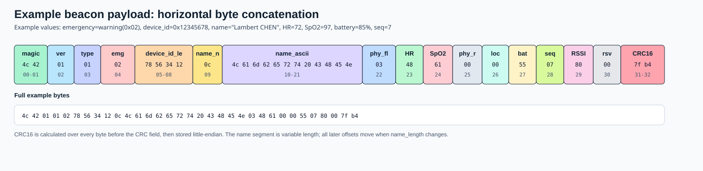

# ESP32-S3 SuperMini 信标测试

本目录是按 PCB I/O 表整理的 MicroPython 联调固件。入口 `main.py` 调用 `pcb_runtime.py`：MAX30102 和 MPU6050 各运行在独立线程；主线程负责屏幕、按键/触摸、TF 自检、日志和 LoRa 信标。每次发包前从 MAX 线程取得一致快照。程序只做联调自检，不是医疗设备。

## GPIO（按用户附图）

| GPIO | 网络 | 器件 |
| --- | --- | --- |
| IO1/IO2/IO3 | LoRa_DIO1/DIO0/RST | Ra-02 |
| IO4 | HR_INT | MAX30102 |
| IO5/IO6 | IIC0 SDA/SCL, 100 kHz | MAX30102、CST816T、MPU6050 |
| IO7 | BAT_TEST / ADC | 电池分压输出 |
| IO8-IO13 | 屏幕 BL/DC/CS/SCK/MOSI/RST | ST7789V，240×280 |
| IO14/IO15 | BTN2/BTN1 | SW2/SW1，低电平按下 |
| IO16-IO18/IO21 | LoRa CS/MOSI/MISO/SCK | Ra-02，SPI2，10 MHz |
| IO33/IO34 | TP_RST/TP_INT | CST816T |
| IO35 | TF_CS | TF 卡，与 LoRa 共用 SPI2 |
| IO38 | MPU_INT | MPU6050 |
| IO48 | RGB | 板载 RGB，保留使用 |

TF 的 CS=GPIO35 是本轮补充分配，图片表中未列出；程序集中在 `pcb_config.py`。GPIO35-37 在部分 ESP32-S3 模组上可能被八线 Flash/PSRAM 占用，必须结合实际模组确认。GPIO48 保留给 RGB，不再用于 TF。

## 接线与安全

- 所有模块使用 3.3 V 电平；MAX30102 地址应为 `0x57`，CST816S/T 通常为 `0x15`。
- Ra-02 上电和发送前必须接 433 MHz 天线。程序在 433.775 MHz 发送，与接收端默认中心频率一致，固定功率为 6 dBm。请在校园/实验室可控场地测试并遵守当地无线电规定。
- IO7 接经过分压的电池电压，沿用原程序分压比 1.67，可在 `main.py` 中校准。
- 没有 GPS，因此 `LOC_FLAG=0`。TF 初始化后写入并读回 `/sd/Hello.txt`，随后卸载。屏幕启动 ST7789V、白底彩色滚动日志；控制台日志用 ANSI 颜色。按键和 CST816T 触摸事件会写入日志。MAX FIFO 由 MAX 线程独占，MPU 线程独立读取加速度、陀螺仪和温度。消息紧急级别仅参考心率和血氧。

## 报文

`build_beacon()` 生成变长二进制报文。主线程以 2000 ms 为目标发送间隔，固定 6 dBm；若一轮耗时超期则跳过追赶，不连发补帧。每次发包前读取 MAX 线程快照，并将有效心率和血氧估计值（或 `0xFF` 无效占位）写入报文。MPU 数据仅用于日志，不改动原报文格式。

LoRa 已启用连续接收。程序兼容接收端定义的 10 字节短呼叫帧 `LB 01 + device_id(4字节小端) + message_type(00) + CRC16-CCITT(2字节小端)`，也兼容完整 LB v1 的 `message_type=0` 请求。收到合法、CRC 正确的请求约 2.5 秒后，程序用发射时的心率、血氧、紧急级别和电池快照构造并发送一帧完整 LB v1 `message_type=2` 应答；应答的其余字段与周期 `message_type=1` 信标格式一致。应答使用独立序号，并在串口输出 `[rx]`、`[response]` 和分段 payload 日志。发送完成后自动恢复连续接收。

CQ 应答使用 `main.py` 中的 `LORA_RESPONSE_FREQUENCY_HZ = 433_375_000`。收到合法 CQ 后按 `LORA_RESPONSE_DELAY_MS = 2500` 非阻塞计时，期间保持 433.775 MHz 监听；等待期间重复 CQ 合并为一次应答，不重新计时。检测到 CQ 后 RGB48 以红色约 250 ms 周期闪烁，直到应答 TxDone 或失败。到期后切频并调用 `start_send()` 启动类型2发射，立即返回；主循环通过 `poll_send()` 检查完成或超时。等待及发射期间继续处理按键、触摸、日志显示及传感器线程，并延后周期信标。应答完成或超时后切回 `LORA_FREQUENCY_HZ = 433_775_000` 并恢复连续接收。单颗 SX1278 在发射期间无法同时接收 CQ。串口记录延时、应答实际频率及恢复监听频率。

报文按以下顺序横向拼接。偏移以 `PERSON_NAME = "Lambert CHEN"` 为例；如果姓名长度改变，`name_ascii` 之后的字段偏移会整体移动。

| 字段 | 偏移 | 长度 | 示例十六进制 | 来源/含义 |
| --- | ---: | ---: | --- | --- |
| `magic` | `00-01` | 2 | `4c 42` | 固定 ASCII `LB` |
| `version` | `02` | 1 | `01` | 协议版本，当前为 v1 |
| `message_type` | `03` | 1 | `00` 请求 / `01` 周期信标 / `02` 应答 | 类型0触发类型2回复 |
| `emergency_level` | `04` | 1 | `02` | 紧急级别：`0=unknown`、`1=normal`、`2=warning`、`3=critical` |
| `device_id_le` | `05-08` | 4 | `78 56 34 12` | 设备 ID，小端序；示例值为 `0x12345678` |
| `name_length` | `09` | 1 | `0c` | ASCII 姓名长度，最大 31 字节 |
| `name_ascii` | `10-21` | 12 | `4c 61 6d 62 65 72 74 20 43 48 45 4e` | `Lambert CHEN` |
| `physiology_flags` | `22` | 1 | `03` | bit0=心率有效，bit1=SpO2 有效 |
| `heart_rate_bpm` | `23` | 1 | `48` | 心率 72 BPM；无效时为 `ff` |
| `spo2_percent` | `24` | 1 | `61` | SpO2 97%；无效时为 `ff` |
| `physiology_reserved` | `25` | 1 | `00` | 生理字段保留字节 |
| `location_flag` | `26` | 1 | `00` | 当前无 GPS，固定为 `00` |
| `battery_percent` | `27` | 1 | `55` | 电量 85% |
| `sequence` | `28` | 1 | `07` | 8 bit 递增序号 |
| `rssi_placeholder` | `29` | 1 | `80` | RSSI 占位值 |
| `reserved_1` | `30` | 1 | `00` | 尾部保留字节 |
| `crc16_ccitt_le` | `31-32` | 2 | `7f b4` | 覆盖 CRC 字段前所有字节，结果小端存储 |



完整示例报文：

```text
4c 42 01 01 02 78 56 34 12 0c 4c 61 6d 62 65 72 74 20 43 48 45 4e 03 48 61 00 00 55 07 80 00 7f b4
```

串口输出也会按同一组字段名打印每段十六进制字节及从 0 开始的偏移，便于和接收端解析逻辑逐字段核对。

## Thonny

先将本目录六个 `.py` 文件全部保存到开发板根目录，再运行 `main.py`。本轮没有更改本地 Thonny 设置或连接硬件；解释器选择 MicroPython (ESP32)，COM 口以实际设备为准。

## VS Code

用 VS Code 打开 `Program\prog_PCB_test` 文件夹。任务会上传六个 Python 文件后重启，沿用端口设置 `COM5`，可以在 `.vscode/settings.json` 修改。从项目根目录手动上传的示例命令如下（本轮未执行）：

```powershell
py -3.11 -m mpremote connect COM5 fs cp Program/prog_PCB_test/pcb_config.py :pcb_config.py
py -3.11 -m mpremote connect COM5 fs cp Program/prog_PCB_test/pcb_screen.py :pcb_screen.py
py -3.11 -m mpremote connect COM5 fs cp Program/prog_PCB_test/pcb_sdcard.py :pcb_sdcard.py
py -3.11 -m mpremote connect COM5 fs cp Program/prog_PCB_test/pcb_runtime.py :pcb_runtime.py
py -3.11 -m mpremote connect COM5 fs cp Program/prog_PCB_test/sx1278.py :sx1278.py
py -3.11 -m mpremote connect COM5 fs cp Program/prog_PCB_test/main.py :main.py
py -3.11 -m mpremote connect COM5 reset
```

若当前 PowerShell 已进入 `Program\prog_PCB_test`，去掉路径前缀即可。支持文件必须随 `main.py` 一起上传。

也可在 VS Code 命令面板运行 `Tasks: Run Task` 中的上传任务。

`ESP32: reset and run` 和默认构建任务 `ESP32: upload then reset` 会 reset、等待 USB CDC 恢复，再用 `mpremote run main.py` 启动当前程序并从第一条日志开始显示；端口尚未就绪时自动重试三次。右上角运行按钮采用同一流程。`Ctrl+C` 中断程序；需要交互式 REPL 时，可另行运行 `mpremote repl`。再次上传前先结束当前运行任务，避免串口占用。若仍提示 COM7 被占用，关闭 Thonny、已有 mpremote REPL 和 VS Code 串口监视终端后重试。

## 自检与调用顺序

1. ST7789V：复位、唤醒、RGB565 模式、色条、白底滚动日志，打开 GPIO8 背光。写入接口无读回线，因此启动日志只证明初始化命令已发出，显示/颜色需目视确认。默认偏移 Y=20，若图像偏移、颠倒或颜色相反，在 `pcb_config.py` 调整 `SCREEN_Y_OFFSET`、`SCREEN_MADCTL`、`SCREEN_INVERT`。
2. I²C：GPIO5/6、100 kHz 扫描；触摸 GPIO33 硬复位后读 ID/坐标寄存器；GPIO34 下降沿只置位事件，由主循环读坐标。按键默认低电平有效、35 ms 去抖，记录按下/释放。触摸休眠导致轮询 NACK 时，仅在实际 IRQ 读取失败时报告。
3. MAX 独立线程：验证 PART_ID=0x15、复位完成、配置写回，100 sps 红光/IR FIFO 采集，运行原有 HR/SpO₂ 原型估算。FIFO 溢出、无手指或数据超过 1 s 未更新时清空有效指标；心跳超过 3 s 未出现时清空 BPM。紧急程度仅由心率和血氧判断。
4. MPU 独立线程：探测 0x68/0x69，验证 WHO_AM_I、复位、配置读回。设置 ±2 g、±250 °/s、内部 100 Hz；线程约每 20 ms 读取最新加速度、陀螺仪、温度（不保证逐样本保存），每帧打印快照和 INT 状态。
5. TF/LoRa：先拉高两个 CS；共用 LoRa SPI2（MicroPython `SPI(1)`），TF_CS=35。卡以低速进入 SPI 模式，识别容量，挂载已有 FAT 文件系统，写入并读回 `Hello.txt`，同步后卸载，不格式化卡。随后以 10 MHz 初始化 Ra-02、验证版本 0x12，固定参数持续发包。屏幕独占 SPI3（MicroPython `SPI(2)`），40 MHz。
6. RGB：GPIO48；发包黄、成功绿、失败红，随后熄灭。电池 GPIO7，主循环每帧输出电压。控制台普通日志使用白色，告警/错误分别用黄/红，`CONSOLE_COLOR=False` 可关闭 ANSI 颜色。

两个采集线程共享 I²C 锁，MAX 算法状态另有快照锁；子线程不操作屏幕、不打印，主线程不再读取 MAX FIFO。启动失败的设备被隔离并记录，其他可用设备继续；线程失败不会自动重新初始化，修复后重新启动。固件必须支持 `_thread` 和至少两个后台线程；线程创建失败会明确记录。`Ctrl+C`/退出时请求线程停止、关闭 RGB、释放 CS。

## 本轮验证边界

仅检查本地源代码和配置语法，未上传、连接串口或测试硬件。上文自检是程序启动后的流程，不能视为已经取得实板通过结果。屏幕驱动依据项目手册中的 ST7789V 240×280 / CST816T；面板方向、颜色、背光极性、触摸坐标和实际模组 GPIO35 可用性仍需实板确认。TF 文件是联调输出，不涉及连续记录。Ra-02 的 TxDone 不等于接收端已收到报文。


## 统一应答与 PPG 重构（2026-11-02）

两版使用同一应答状态机：433.775 MHz 监听合法 CQ，红灯闪烁，非阻塞等待 2500 ms 后切到 433.375 MHz 发出完整类型2报文，再恢复监听。重复 CQ 合并，不延长截止时间。周期报文仍为类型1。

MAX30102 由独立线程以20 ms间隔轮询100 Hz FIFO，主线程只读取加锁快照。vitals.py 参考 C 项目的 hr.c/spo2.c/anc.c/sqi.c：DC去除、低通、16阶NLMS、RRI 0.6~1.7异常剔除、8次间隔平滑、200点红光/红外血氧窗口；加入光学相关性、灌注、饱和、突变、脱指和FIFO溢出失效保护。PCB版仅在MPU数据新鲜时使用加速度模长去重力参考；缺少MPU时保留光学滤波，日志明确运动未验证，不声称完成运动补偿。MicroPython版未移植ESP-DSP FFT/模板SQI，采用轻量时域质量门控。SpO2=110-25R是待标定估计，不能作为医用指标。独立版保留原GPIO，不初始化屏幕/TF/MPU。

上传时必须包含 main.py、pcb_config.py、pcb_runtime.py、sx1278.py、vitals.py；PCB版另外包含屏幕/TF驱动。任务已更新。未进行实板上传和验证。
