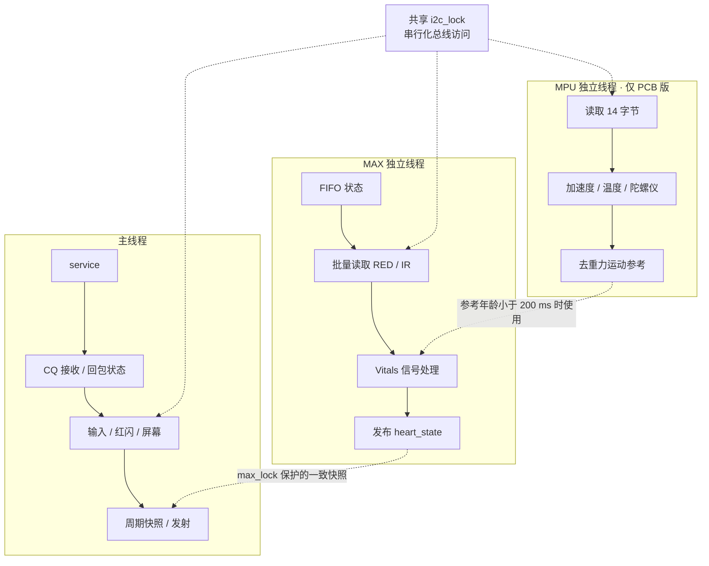
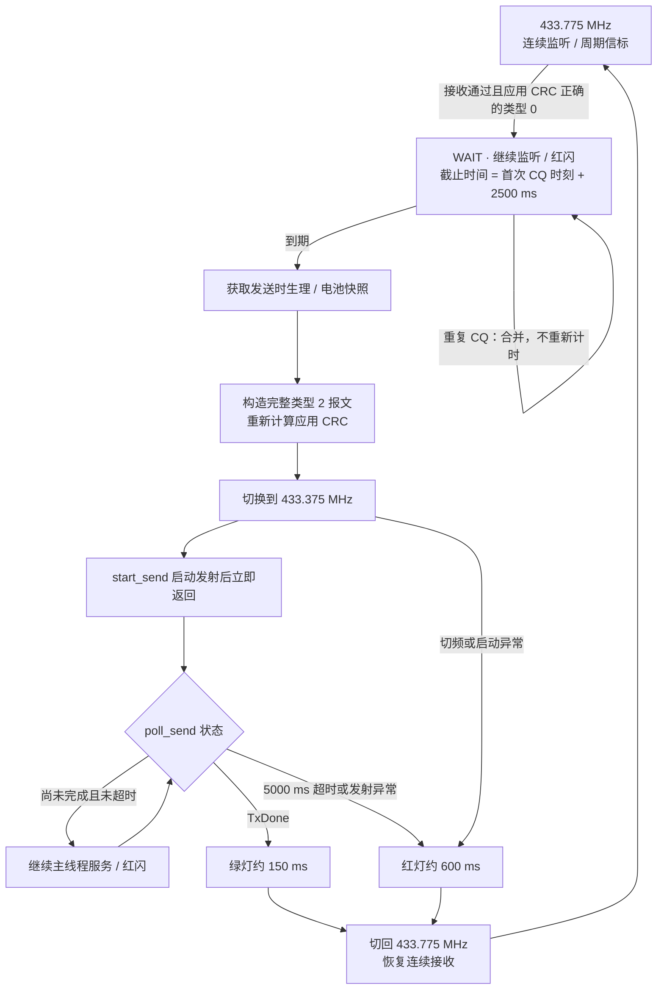
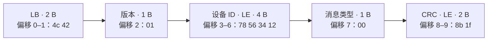

# Beacon端固件技术手册

本仓库根目录是 PCB 版固件源码，对应项目工作区的 `Program/prog_PCB_test`。手册同时说明工作区 `Program/prog_test` 的独立接线配置；独立版源码不随本仓库发布。接线、电源和模块验收见[硬件技术手册](docs/硬件技术手册.md)。

## 阅读导航

- 第1-5节：运行范围、文件、参数、启动和线程。
- 第6-8节：MAX30102采集、心率血氧与SQI。
- 第9-11节：CQ应答、二进制报文与紧急级别。
- 第12-15节：日志、上传、验证和维护。
- 第16-23节：完整配置与接口、寄存器、计算顺序、外设驱动、异常及术语。

## 1. 软件范围和版本关系

两版在ESP32-S3 MicroPython上执行MAX30102心率/血氧估算、LB v1周期信标和CQ应答。PCB版启用屏幕、TF启动自检、MPU线程、按键和触摸硬复位。独立版按原测试接线运行，不初始化这些PCB外设。

`prog_test` 通过 `pcb_runtime.py` 和 `pcb_config.py` 运行，`STANDALONE=True` 关闭PCB专用外设。两版共用算法和协议实现，引脚配置、身份和电池参数分别保存在各自目录。

算法参考为 `Program/MPU6050-MAX30102-backup-20261014/main/` 的MAX采集、ANC、HR、SpO2和SQI程序。当前固件未启用C项目中的跌倒、呼吸、长按SOS、动态发送间隔和连续TF日志，报文继续使用LB v1。接收中心独立运行，板端启动无需导入接收中心软件。

## 2. 文件与运行依赖

| 文件 | 职责 | 上传要求 |
| --- | --- | --- |
| main.py | 常量、MAX初始化/FIFO读取、快照转协议、CRC、紧急级别、入口 | 两版必需 |
| pcb_config.py | GPIO、SPI/I²C参数、独立模式标志 | 两版必需，不能交叉混用 |
| pcb_runtime.py | 主循环、MAX/MPU线程、锁、CQ状态机、交互/日志 | 两版必需 |
| sx1278.py | SPI寄存器访问、调频、连续RX、同步TX和非阻塞TX | 两版必需 |
| vitals.py | DC去除、NLMS、低通、峰/RRI、血氧与质量门控 | 两版必需 |
| ppg_quality.py | PI、FFT SNR、RRI CV、模板、年龄和运动SQI | 两版必需 |
| pcb_screen.py | ST7789V白底彩色日志 | PCB版必需 |
| pcb_sdcard.py | SD SPI块设备及初始化 | PCB版必需 |
| verify_local.py | CPython离线验证 | 留在开发机，不需要上传 |
| .vscode/ | 上传/运行任务、端口、启动器 | 留在开发机 |

运行文件须完整上传到开发板根目录：PCB版8个，独立版6个，文件范围见上表。MicroPython需提供 `machine`、`struct`、`time.ticks_*`、`math` 和 `_thread`；PCB屏幕还需 `framebuf`，TF需FAT挂载支持。`neopixel` 缺失时程序禁用RGB，其余流程继续。

PCB版尝试创建MAX和MPU两个后台线程，能否同时运行取决于MicroPython构建的线程支持。缺少 `_thread` 时程序禁用传感器采集并报告失败，不执行主循环同步采集。

依据：两版 `main.py` 的导入项、[Runtime.start_workers](./pcb_runtime.py)及 `STANDALONE` 分支。

## 3. 当前参数表

| 参数 | PCB版 | 独立版 | 定义位置/说明 |
| --- | --- | --- | --- |
| PERIOD_MS | 2000 | 2000 | main.py；周期信标目标间隔 |
| LORA_FREQUENCY_HZ | 433775000 | 433775000 | 平时监听/类型1发射 |
| LORA_RESPONSE_FREQUENCY_HZ | 433375000 | 433375000 | 类型2回包 |
| LORA_RESPONSE_DELAY_MS | 2500 | 2500 | 首个合法CQ后的等待 |
| LORA_TX_POWER_DBM | 6 | 6 | 驱动钳位范围2-17 dBm |
| LoRa PHY | BW125 kHz、SF7、CR4/5、显式头、PHY CRC | 同左 | 当前驱动写死寄存器配置 |
| PERSON_NAME | DEMO2_PCB | DEMO | ASCII编码，最多31字节 |
| DEVICE_ID | 0 | 0 | 0表示对machine.unique_id()做32位FNV-1a散列 |
| BATTERY_DIVIDER | 1.57 | 1.67 | ADC软件还原倍数 |
| 电量范围 | 3200-4200 mV | 3300-4200 mV | 线性映射并限制0-100 |
| RGB | GPIO48，亮度16/255 | 同左 | 无法初始化时跳过 |
| I²C | SDA5/SCL6，100 kHz | SDA5/SCL4，100 kHz | pcb_config.py |
| LoRa SPI | SPI(1)，10 MHz | SPI(2)，5 MHz | pcb_config.py |
| 默认开发串口 | COM7 | COM5 | .vscode/settings.json；以实际设备为准 |

`LORA_BANDWIDTH_KHZ`、`LORA_SPREADING_FACTOR` 和 `LORA_CODING_RATE` 等常量用于日志；驱动直接写入对应的PHY寄存器。调整这些参数时，维护人员须同步修改驱动。同步字沿用芯片复位默认0x12，代码没有显式写入；前导码等未配置项也依赖复位默认值。主程序实际向驱动传入频点和功率。

`SPO2_WINDOW_SAMPLES=100` 和部分 `heart_state` 累计字段未参与当前窗口计算。有效窗口由 `vitals.py` 中的200点缓存决定。

参数来源：[PCB main.py](./main.py)、独立版 main.py（工作区文件：`Program/prog_test/main.py`）、两版 `pcb_config.py`、`.vscode/settings.json`及[SX1278.begin](./sx1278.py)。

## 4. 启动、自检和关闭

入口导入模块并创建 `Vitals()`，随后 `main()` 等待5秒，再调用 `pcb_runtime.run(globals())`。CQ等待由独立参数控制，见第3节。导入 `main.py` 会直接尝试访问硬件；离线测试用AST提取协议函数，避开入口执行。

启动顺序：

1. 创建运行对象、配置片选/按键/中断脚；PCB尝试初始化屏幕与背光。
2. 初始化I²C并扫描；初始化RGB和ADC。
3. 探测触摸；启动MAX后台线程，PCB另启动MPU后台线程。
4. 建立LoRa/TF SPI；PCB先执行TF写入/读回自检再卸载。
5. LoRa硬复位并检查VERSION=0x12，配置PHY和功率，进入连续接收。
6. 首个周期发送目标设为此时之后500 ms；进入服务循环。

`attempt()` 按设备捕获初始化异常并记录。`dedicated thread started`表示线程创建调用成功，传感器状态由后续日志报告。部分启动日志使用固定的PCB引脚文字，独立版应按配置文件核对接线。

`finally` 调用 `close()` 请求线程停止，并注销触摸IRQ、释放CS、熄灭RGB。程序最多等待线程约2秒，未退出时提示软复位。线程故障后须人工重新启动；代码未配置软件看门狗或持久化任务恢复。

流程来源：`main.py` 的 `main()` 和[Runtime.run、close](./pcb_runtime.py)。

## 5. 并发、锁与调度



MAX线程每轮休眠20 ms，一轮可处理多个FIFO样本。传感器样本率与线程调度周期分别设置。MPU约20 ms读一次，参考年龄小于200 ms时供MAX使用；同一FIFO批次可能使用相同参考，两者未做硬件同步采样。

`i2c_lock` 串行化I²C访问，`max_lock` 保护MAX算法状态。获取顺序为MAX状态锁→I²C锁。主线程持MAX锁读取一致快照，子线程不打印或绘屏。MAX算法在受锁保护的调用路径中执行，FFT和I²C共享锁会增加其他任务的等待时间。

主循环先检查无线电，再处理输入；屏幕约每100 ms检查脏标志。普通空闲和应答阶段短休眠约2 ms，锁等待、SPI绘屏、串口输出和GC会延长实际周期。周期信标调用同步 `send(..., poll=service)`，等待TxDone时继续服务其他任务。CQ回包通过 `start_send()/poll_send()` 分次启动和检查发射状态。

实现来源：[Runtime.service、max_worker、mpu_worker](./pcb_runtime.py)与[SX1278.send](./sx1278.py)。

## 6. MAX30102 驱动与数据有效性

初始化先探测0x57，确认PART_ID=0x15，并在500 ms截止时间内等待软件复位完成。程序清零FIFO写指针、溢出计数和读指针，设置FIFO_CONFIG=0x1F、MODE_CONFIG=0x03、SPO2_CONFIG=0x27、RED/IR LED=0x24，再读回关键寄存器。

RED/IR每组占6字节，解码后用0x03FFFF保留18位。程序以 `(write_ptr-read_ptr)&0x1F` 计算组数，再从0x07读取 `count*6` 字节。模32计数只能直接表示0至31组；满FIFO判定还依赖溢出计数和轮询时效保护。

结果失效条件由 `max_worker()`、`read_health()` 和 `Vitals.update()` 分别检查：

| 条件 | 当前行为 |
| --- | --- |
| FIFO溢出 | 清读写指针和溢出计数，重置算法 |
| MAX线程相邻处理间隔>250 ms | 清FIFO和算法，避免错误时间基准 |
| 快照距最后有数据采样≥1000 ms | 撤销生理有效性并重置算法 |
| RED或IR<10000 | 视为接触不足，重置 |
| 任一原始通道≥260000 | 饱和保护，重置 |
| 原始值相对DC偏差>25% | 阶跃伪影保护，重置 |
| 已知运动参考绝对值>0.15 g | 强运动伪影重置 |
| 最新IR≤12000 | 不作为有效心率/血氧输出；线程也有低IR清除逻辑 |
| 无峰>300点 | 清心率候选、RRI与历史，血氧仍按窗口独立判断 |

RRI和算法年龄按100 Hz样本计数计算。线程停顿与快照过期使用墙钟 `ticks_ms`，算法年龄则从最近有效HR间隔事件起算。

依据：[main.py](./main.py) 的 `init_max30102()`、`sample_max30102()`、`read_health()`，以及[Runtime.max_worker、health_snapshot](./pcb_runtime.py)。

## 7. 心率、血氧和运动补偿

### 7.1 DC去除和滤波

RED和IR各自更新DC基线：`dc += 0.03*(raw-dc)`。减去DC后，可用运动参考驱动两路独立的16阶NLMS，步长0.001，能量正则项1e-6。随后用 `lp += 0.2*(ac-lp)` 低通，各保留最近200点。

PCB运动参考为 `sqrt(ax²+ay²+az²)-acc_mean`，慢均值按 `acc_mean += 0.01*(mag-acc_mean)` 更新。MPU缺失或参考过期时，程序跳过NLMS并记录 `motion_verified=False`。独立版默认无运动参考，输出只能说明光学检查结果。

### 7.2 心率

峰检测使用最近100点的 `min+0.6*(max-min)` 阈值。连续合格样本达到500点后，程序开始接受阈值上穿事件。峰间隔为25至200点，对应30至240 bpm；与上次有效间隔的比值须在0.6至1.7内。最近8个有效间隔的均值用于 `round(6000/平均间隔点数)`。HR输出还要等待第二个可用峰和SQI发布周期，预热结束后仍可能暂时无值。

### 7.3 血氧

使用最近200个原始RED/IR样本的窗口均值作DC、峰峰值作AC：

```text
R = (RED_AC / RED_DC) / (IR_AC / IR_DC)
SpO2_estimate = 110 - 25 × R
```

R须在0.4至3内，血氧估计须在70至100内，结果四舍五入后还要通过质量检查。附加光学条件要求滤波后RED/IR的未去均值归一化相关量>0.7，且滤波IR幅度/DC>0.001。SQI的模板相关使用另一种计算，见第8节。

A=110、B=25是待标定系数。测试人员须用实物传感器、安装结构和参考仪器拟合，再评价佩戴时的测量误差。合成信号测试只覆盖算法输入输出。

实现来源：[Vitals.update](./vitals.py)与 `pcb_runtime.py` 的 `mpu_worker()`。

## 8. 六维 SQI

`Quality.evaluate()` 每100点调用一次，约1 Hz；输入窗口不足200点时继续积累样本。

| 维度 | 指标 | 阈值 | 权重 |
| --- | --- | ---: | ---: |
| PI | 原始IR峰峰值/均值×100 | 0.5%（越高越好） | 0.30 |
| RRI CV | 最近有效RRI的标准差/均值 | 0.15（越低越好） | 0.20 |
| FFT SNR | 主峰及相邻频点功率/分析带总功率 | 0.3 | 0.15 |
| 模板 | 前后两次最近50点片段的Pearson相关映射至0-1 | 0.7 | 0.10 |
| ACC | 最新运动参考绝对值 | 0.035 g（越低越好） | 0.10 |
| AGE | 由样本计数距最近有效HR间隔事件的年龄 | ≤10秒满分，60秒归零 | 0.15 |

高优指标用 `min(1,value/threshold)` 评分；低优指标在阈值内满分，超出时用 `threshold/value`。加权总分须≥60，PI须≥0.5%，已知ACC须≤0.035 g，年龄须<60秒。未知ACC得0分，不触发运动硬否决，日志仍保留未验证标记。RRI不足3个时，有历史则CV暂按0，无历史按1；首个模板暂按满分。

FFT先对200点IR去均值并加Hann窗，再补零至256点，执行基2变换。Fs=100 Hz，频点间隔约0.390625 Hz；频率边界按整数取整，低端从bin1开始，未实现严格的0.5 Hz截止。SNR记录谱能量占比，单位为比例。模板比较相邻SQI更新时各自的最近50点片段，未对齐单次心搏。

HR/SpO2发布须同时通过SQI和附加光学检查，失败时质量状态为 `PPGLOSS`。`metrics.valid`只表示SQI结果，各生理值还须满足自己的范围条件。日志字段为 `sqi/pi/snr/rri_cv/template/age/age_score/motion/motion_verified/valid`。

实现来源：[Quality.evaluate、spectral_snr](./ppg_quality.py)与[最终发布条件](./vitals.py)。

### 8.1 算法约束与计算开销

C参考代码中的NLMS、HR/RRI、ratio-of-ratios和六维SQI分别对应当前处理链。C配置FIFO_CONFIG=0x4F，启用4点平均；当前配置0x1F维持有效100 Hz输出。FFT采用200点窗补零至256点，每秒执行一次。通道滤波、相关性检查、伪影保护、RRI平滑和新鲜度检查采用前述实现条件。

窗口和FFT工作区长度有界，处理时仍产生切片、浮点对象和前端pop。代码未使用无分配定长环形数组；CPU占用、GC时延和FIFO溢出率须由固件维护人员在MicroPython实板测量。

参考来源：`Program/MPU6050-MAX30102-backup-20261014/main/` 下的 `max30102.c`、`anc.c`、`hr.c`、`spo2.c`、`sqi.c`。

## 9. CQ应答状态机与LED



红灯在等待和应答发射期间每250 ms切换亮灭，完整周期约500 ms；普通信标发射使用黄色。等待期间重复CQ合并为一次应答，不改变截止时间，周期信标延后。周期序号和应答序号各自按0至255循环，接收端须结合消息类型区分。

应答使用本机身份和发送时生理状态构造，类型为2，并重新计算CRC。截止时间后还需获取锁、构包、输出日志和切换SPI频率，因此实际空中发射时间受任务调度影响。发射期间无法接收CQ；当前也没有请求队列、随机退避和多机避碰。

短CQ的4字节ID只解析并打印为target，未与本机ID比较，合法短CQ使用任意ID均可触发应答。`build_call_packet(target_device_id)`只负责构造字段。协议没有加密和认证，CRC用于检测误码。

实现来源：[Runtime.poll_radio、schedule_response、send_response、finish_response](./pcb_runtime.py)及[SX1278.start_send、poll_send](./sx1278.py)。

## 10. 二进制协议

### 10.1 完整LB v1（类型1/2及兼容的完整类型0）

完整报文总长为`21+N`字节，N为ASCII姓名长度，范围0至31。多字节整数按小端存储。

| 偏移（从0起） | 字段 | 长度 | 规则 |
| --- | --- | ---: | --- |
| 0-1 | magic | 2 | ASCII LB，4c 42 |
| 2 | version | 1 | 01 |
| 3 | message_type | 1 | 01周期；02应答；00请求 |
| 4 | emergency_level | 1 | 0未知/1正常/2警告/3危急 |
| 5-8 | device_id | 4 | 本机32位ID |
| 9 | name_length | 1 | N |
| 10～9+N | name_ascii | N | ascii replace，再截断31字节 |
| 10+N | physiology_flags | 1 | bit0 HR有效，bit1 SpO2有效 |
| 11+N | heart_rate_bpm | 1 | 无效FF |
| 12+N | spo2_percent | 1 | 无效FF |
| 13+N | physiology_reserved | 1 | 00 |
| 14+N | location_flag | 1 | 00，无GPS |
| 15+N | battery_percent | 1 | 0-100，ADC不可用时FF |
| 16+N | sequence | 1 | 各消息流8位序号 |
| 17+N | rssi_placeholder | 1 | 80，不能解释为实测RSSI |
| 18+N | reserved_1 | 1 | 00 |
| 19+N～20+N | crc16_ccitt_le | 2 | 覆盖此前全部字节 |

横向拼接：

```mermaid
flowchart LR
    MAGIC["LB<br/>2 B"] --> VERSION["版本<br/>1 B"]
    VERSION --> TYPE["类型<br/>1 B"]
    TYPE --> EMERGENCY["紧急级别<br/>1 B"]
    EMERGENCY --> ID["设备 ID · LE<br/>4 B"]
    ID --> LEN["姓名长度 N<br/>1 B"]
    LEN --> NAME["姓名<br/>N B"]
    NAME --> FLAGS["生理标志<br/>1 B"]
    FLAGS --> HR["心率<br/>1 B"]
    HR --> SPO2["血氧<br/>1 B"]
    SPO2 --> PHYRSV["生理保留<br/>1 B"]
    PHYRSV --> LOC["定位标志<br/>1 B"]
    LOC --> BAT["电量<br/>1 B"]
    BAT --> SEQ["序号<br/>1 B"]
    SEQ --> RSSI["RSSI 占位<br/>1 B"]
    RSSI --> RSV["尾部保留<br/>1 B"]
    RSV --> CRC["CRC · LE<br/>2 B"]
```



类型2构造示例采用ID=0x12345678、姓名DEMO、紧急级别1、有效HR72/SpO2 95、电量50%和应答序号1。这些值用于协议复算，不是测量记录。

```text
4c 42 | 01 | 02 | 01 | 78 56 34 12 | 04 | 44 45 4d 4f | 03 | 48 | 5f | 00 | 00 | 32 | 01 | 80 | 00 | 05 68
```

示例长25字节，CRC数值为0x6805，小端字节为05 68。PCB默认姓名DEMO2_PCB对应30字节，独立版DEMO对应25字节，解析时须按姓名长度计算后续偏移。

字段来源：两版 `main.py` 的 `build_beacon()`、`print_payload_segments()`；CRC和类型2检查见 `verify_local.py`。

### 10.2 短CQ

短CQ固定10字节，没有独立设备类型字节。`[type][device_type][CRC]` 的4字节结构不属于当前协议。



短CQ的type位于偏移7，完整包位于偏移3。接收函数先检查短CQ的长度、LB/版本和type，再校验CRC；不满足短包条件时进入完整包兼容分支。

实现来源：`main.py` 的 `build_call_packet()`与 `pcb_runtime.py` 的 `poll_radio()`。

### 10.3 CRC和接收校验边界

应用CRC使用多项式0x1021、初值0xFFFF、非反射、无最终异或，结果以小端存储，等价于 `binascii.crc_hqx(body,0xffff)`。LoRa PHY CRC在射频层单独处理。

驱动在RxDone和PayloadCrcError同时置位时丢包并清标志，未另外检查头部是否声明携带PHY CRC。短CQ按固定长度校验；完整包兼容分支只检查最小长度7、LB/版本、CRC和type，未严格检查完整 `21+N` 布局。构造器会生成完整类型1/2报文，接收入口仍可能接受结构不完整但CRC正确的类型0帧。

实现来源：`main.py` 的 `crc16_ccitt()`、`pcb_runtime.py` 的 `poll_radio()`和 `sx1278.py` 的 `receive_nonblocking()`。

## 11. 紧急级别与输出语义

| 类别 | 原型判定条件 |
| --- | --- |
| CRITICAL=3 | 有效HR<40或>150，或有效SpO2<90 |
| WARNING=2 | 未达危急，有效HR<50或>120，或有效SpO2<94 |
| NORMAL=1 | 两项均有效且未触发上述阈值 |
| UNKNOWN=0 | 两项无效，或仅一项有效且未触发异常阈值 |

阈值判断使用严格小于或大于，等于阈值时不触发该条件。紧急级别只使用HR和SpO2；SQI通过有效标志间接影响分级，呼吸和MPU跌倒未参与。该逻辑用于原型遥测。

实现来源：[classify_vital_emergency](./main.py)。

## 12. 屏幕、TF、交互和日志

屏幕尺寸、像素格式、偏移和ASCII限制见[硬件手册第7节](docs/硬件技术手册.md#7-屏幕触摸与按键)。`append()`保留末尾可显示行，`render()`在内容变更后刷新，字符替换结果为`?`。控制台INFO白、OK绿、WARN黄、ERROR红；`CONSOLE_COLOR=False`关闭ANSI颜色。

TF启动自检写入并读回 `/sd/Hello.txt` 后卸载，未连续保存PPG或报文。按键按35 ms去抖，低电平表示按下。触摸IRQ只置位，主线程读取0x01起6字节，报告DOWN/MOVE/released；松开时约200 ms轮询，按下时约50 ms。实际IRQ读取失败会报告，休眠NACK须结合供电和触摸状态判断。

实现来源：[ScreenLog](./pcb_screen.py)及 `pcb_runtime.py` 的 `log()`、`inputs()`、`tf_test()`。

| 日志 | 能证明什么 | 不能证明什么 |
| --- | --- | --- |
| scn init sent | 已执行命令发送 | 图像/方向/颜色正确 |
| dedicated thread started | 线程创建调用成功 | 器件ID和采样成功 |
| max samples / quality / SQI | 算法快照与门控状态 | 医学测量准确 |
| rx short CQ / scheduled | 已接受CQ并安排等待 | 定向ID过滤已执行 |
| ResponseTxStarted | 已启动类型2发射 | 射频已成功到达中心 |
| TxDone / ResponseTxDone | 芯片发射完成标志 | 接收中心通过解码 |
| RX resumed | 已调用恢复频率/接收流程 | 实测接收灵敏度 |

## 13. 上传和启动操作

设备上传流程为草稿，待实板验证。联调人员先关闭Thonny、旧mpremote和串口监视器，释放端口。以下操作分为本地检查、设备写入和人工检查；设备写入会覆盖同名文件，执行前应另行保存板上版本。

### 13.1 VS Code

联调人员用VS Code打开对应程序文件夹，核对 `.vscode/settings.json` 的端口，再按 `Ctrl+Shift+B`执行 `ESP32: upload then reset`。任务先上传全部依赖，再reset/run；运行配置通过preLaunchTask执行同一上传流程。

`esp32_run_entry.py` reset后等待USB CDC约1.5秒，再用 `mpremote run` 执行本地main.py，非零退出时最多重试3次。设备端异常也可能进入重试，排障时应读取前面的traceback。reset只重启设备；`mpremote run main.py`执行本地入口，导入模块仍从板上读取。

依据：`.vscode/tasks.json`、`.vscode/launch.json`和 `.vscode/esp32_run_entry.py`。

### 13.2 手动全套上传（PCB目录内执行）

```powershell
$port = 'COM7'  # 按实际端口修改
$files = @('pcb_config.py','ppg_quality.py','vitals.py','sx1278.py',
           'pcb_screen.py','pcb_sdcard.py','pcb_runtime.py','main.py')
foreach ($file in $files) {
    py -3.11 -m mpremote connect $port fs cp $file ":$file"
    if ($LASTEXITCODE -ne 0) { throw "Upload failed: $file" }
}
py -3.11 .vscode/esp32_run_entry.py $port main.py
```

独立版上传列表去掉 `pcb_screen.py`、`pcb_sdcard.py`，默认端口见第3节。使用Thonny时，联调人员将全部运行文件保存到板根目录，选择MicroPython ESP32解释器和实际端口，再复位运行。板端main.py依赖MicroPython硬件模块，开发机普通Python不能直接执行。

查看板上程序日志可用 `mpremote connect COM7 repl`，退出按Ctrl+]或Ctrl+X以释放端口。程序被中断后需重新启动。出现 `ImportError: no module named ...` 时，补传板端缺失文件。

回退方式：停止串口任务，将事先保存的整套运行文件上传到板根目录后复位。没有备份时，无法恢复被覆盖文件的原内容。验收应检查启动日志、依赖导入、传感器状态和类型2返回包；这些项目须由首次实板执行者记录结果。

## 14. 开发机验证与故障处理

```powershell
py -3.11 verify_local.py
py -3.11 -m compileall -q .
```

本地检查覆盖合成72 bpm/约95%血氧、脱指、强运动、平直输入、谱能量、SQI运动与60秒年龄条件，以及类型2CRC和10字节CQ构造。语法检查可在开发机运行。测试范围不含MicroPython线程能力、总线电气、RF互通、CQ完整时序、SD兼容性、长期内存和所有异常路径。

本地命令只检查开发机文件；设备故障表按症状列出排查方向，实板分支待验证。测试依据：两版 `verify_local.py`。

| 现象 | 处理方向 |
| --- | --- |
| COM端口被占用 | 结束旧任务/REPL、关闭Thonny和监视器，核对设备管理器端口 |
| 日志仍为旧频率/旧功能 | 全量上传模块再reset，仅run入口不足以更新驱动 |
| MAX持续warming | 等待合格样本与峰；检查IR、接触和重置原因 |
| PPGLOSS | 查看PI、motion、相关性和SQI，确认不是运动或低灌注门控 |
| FIFO经常reset | 测线程停顿、FFT耗时、屏幕/串口负载及I²C锁等待 |
| CQ无响应 | 确认433.775 MHz、SF7/BW125、type偏移、长度、CRC及是否处于发射空窗 |
| 红闪但中心收不到 | 中心及时转433.375 MHz；核对实际参数和类型2 CRC，区分TxStarted与TxDone |
| TF自检停留较久 | LoRa启动在TF之后，查看卡初始化错误/超时；勿误判为无线电监听阶段 |
| 电量异常 | 核对ADC引脚/原始值/实装分压/还原倍数，不用HR算法解释ADC问题 |

## 15. 维护与交付约定

维护人员变更硬件后先同步 `pcb_config.py`；变更协议时同步构造函数、接收条件、CRC示例和两版测试。PPG变更应记录采样率、窗口、阈值、参考输入及有效标志的影响。LB v1字段和CQ类型2应答保持第10节定义。

PCB仓库远端为 `cyx728/LifeBeacon-PCB-MicroPython`。发布前用 `git status` 核对未提交内容，再审查diff，排除令牌、个人生理记录和含身份信息的串口历史。根README对应本手册，发布时应同时校验链接和源码版本。

实板验收记录应保存日期、固件版本、接线照片、原始日志、测试条件和结果。源码定义的参数与实测结果分别记录。


## 16. 配置项与状态字段参考

本节列出第3节摘要表以外的配置。引脚按GPIO编号配置；所有SPI实例均使用polarity=0、phase=0。修改配置后须全套上传并复位。源码：[pcb_config.py](./pcb_config.py)、[main.py](./main.py)。

### 16.1 PCB GPIO与显示配置

| 配置键 | 默认值 | 用途 |
| --- | --- | --- |
| I2C_SDA / I2C_SCL / I2C_HZ | 5 / 6 / 100000 | I²C0共享总线 |
| HR_INT / BAT_TEST | 4 / 7 | MAX中断输入和ADC |
| LORA_DIO1 / LORA_DIO0 / LORA_RST | 1 / 2 / 3 | 无线电数字接口 |
| LORA_CS / LORA_MOSI / LORA_MISO / LORA_SCK | 16 / 17 / 18 / 21 | LoRa与TF共享SPI |
| LORA_SPI_ID / LORA_SPI_HZ | 1 / 10000000 | LoRa阶段总线配置 |
| SCREEN_BL / SCREEN_DC / SCREEN_CS | 8 / 9 / 10 | 屏幕控制 |
| SCREEN_SCK / SCREEN_MOSI / SCREEN_RST | 11 / 12 / 13 | 屏幕串行输入与复位 |
| SCREEN_SPI_ID / SCREEN_SPI_HZ | 2 / 40000000 | 独立显示总线 |
| SCREEN_WIDTH / SCREEN_HEIGHT / SCREEN_Y_OFFSET | 240 / 280 / 20 | 像素窗口及控制器行偏移 |
| SCREEN_MADCTL / SCREEN_INVERT / SCREEN_BL_ON | 0x00 / True / 1 | 扫描方向、反色、背光极性 |
| BTN1 / BTN2 / BUTTON_ACTIVE | 15 / 14 / 0 | 去抖按键及按下电平 |
| TOUCH_RST / TP_INT / MPU_INT | 33 / 34 / 38 | 触摸复位和中断输入 |
| TF_CS / RGB_PIN | 35 / 48 | TF独立片选、NeoPixel |
| CONSOLE_COLOR | True | 控制台ANSI颜色开关 |
| STANDALONE | PCB文件未定义，运行时默认False | 关闭PCB专用分支 |

独立版的STANDALONE=True，SDA/SCL=5/4，HR_INT/BAT_TEST/TP_INT=7/1/6，DIO0/DIO1/CS/RST=8/9/10/14，MOSI/SCK/MISO=11/12/13，SPI_ID/SPI_HZ=2/5000000。RGB_PIN=48、BUTTON_ACTIVE=0、CONSOLE_COLOR=True。独立版未定义屏幕、TF和MPU专用键，分支跳过这些访问。不得只将PCB配置的STANDALONE改为True就当作原独立接线配置。

### 16.2 主程序其余常量

| 配置键 | 默认值 | 用途 |
| --- | --- | --- |
| ONE_SHOT | False | True时完成一次周期发送尝试后退出；并非仅发送一次CQ应答 |
| RGB_ENABLED | True | 控制是否初始化NeoPixel |
| RGB_PIN | cfg.RGB_PIN | RGB引脚别名 |
| RGB_BRIGHTNESS | 16 | 每通道乘16再整除255 |
| RGB_TX_COLOR | (255,255,0) | 普通信标发射黄色 |
| MAX30102_ADDR | 0x57 | MAX寄存器和FIFO地址 |
| MAX30102_SAMPLE_PERIOD_MS | 10 | 保留的采样周期说明常量，当前算法按100 Hz内部计数 |
| SPO2_WINDOW_SAMPLES / SPO2_MIN_DC_IR | 100 / 10000 | 保留常量，不驱动当前Vitals窗口/阈值 |
| EMERGENCY_UNKNOWN / NORMAL / WARNING / CRITICAL | 0 / 1 / 2 / 3 | 对应完整EMERGENCY_前缀常量 |
| HR_WARNING_LOW / HR_WARNING_HIGH | 50 / 120 | 警告界限 |
| HR_CRITICAL_LOW / HR_CRITICAL_HIGH | 40 / 150 | 危急界限 |
| SPO2_WARNING_LOW / SPO2_CRITICAL_LOW | 94 / 90 | 血氧警告/危急界限 |
| BAT_TEST / I2C_SCL / I2C_SDA | cfg同名键 | 主程序硬件别名 |

DEVICE_ID非零时取低32位；为0时散列硬件ID。散列初值0x811C9DC5，每字节先异或再乘0x01000193，最后保留低32位。该值用作身份标识，未保证全球唯一，也没有密码学认证意义。

### 16.3 heart_state与运行状态

| 字段/组 | 初值或更新者 | 用途 |
| --- | --- | --- |
| bpm / spo2 | None；MAX线程 | 经门控后发布的整数或None |
| last_ir / sample_count | 0；MAX线程 | 最近原始IR、累计读取样本组数 |
| quality / sqi | 采样后动态加入 | 状态字符串与SQI字典副本 |
| baseline / amplitude / above / last_peak_ms | 0 / 0 / False / None | 保留字段，当前Vitals不更新它们 |
| red_sum / ir_sum / red_min / red_max / ir_min / ir_max / spo2_count | 0、最小值初值0x03FFFF | 保留累计字段，不用于当前血氧结果 |
| max_status / mpu_status | (False,'pending') | 状态元组，由采集线程发布 |
| max_done / mpu_done | True，启动线程前设False | 关闭时等待标志 |
| max_last_ms | None，非空批次后更新时间 | 新鲜度判断 |
| max_alive_ms | None，每轮FIFO处理后更新 | 停顿检查，即使未取到样本也更新 |
| mpu_data / mpu_alive_ms | None | 最新七项数据和时间 |
| motion_ref / acc_mean | None / 1.0 | MPU运动参考及慢均值 |
| response_seq / response_due_ms / response_active | 0 / None / False | 应答序号、截止时间、在发状态 |
| periodic_tx_active | False | 同步信标发射期间禁止RX轮询 |
| response_led_next_ms / response_led_on / rgb_off_at | None / False / None | 红闪与短亮截止状态 |
| touch_pending / touch_ok / touch_down | bytearray(1) / False / False | IRQ标记、初始化和按压状态 |
| raw_buttons / stable_buttons / button_changed | 引脚初值 / None / 时间戳 | 35 ms去抖状态 |
| last_render / last_status | 当前时间 / None | 屏幕刷新与状态日志去重 |
| api | main.py传入的globals字典 | 主程序函数/常量访问，不使用反射式硬件自动发现 |

invalidate_health()重置Vitals及有效结果，但不清sample_count和last_ir；日志可继续显示累计样本和最后IR。MAX线程中基于heart_state.last_peak_ms的旧超时分支通常不生效，实际无峰超时由Vitals内部样本计数负责。独立版跳过MPU线程后mpu_status仍可保持pending，不能据此判定独立版启动失败。

## 17. 模块调用接口

以下接口均来自同名源文件。函数未注明异常捕获时，I²C/SPI或参数异常会向调用者传播。所有板端函数在MicroPython解释器运行；离线测试脚本只提取纯协议函数。

### 17.1 main.py

| 接口 | 输入/返回 | 调用约束 |
| --- | --- | --- |
| crc16_ccitt(data) | 字节迭代器→16位整数 | 不向输入追加CRC |
| device_id() | 无参数→32位整数 | 优先使用显式DEVICE_ID |
| init_battery() | →ADC对象 | 设置ATTN_11DB |
| battery_mv(adc) | →还原后的整数mV | read_u16不可用时改用read；其他异常不在函数内处理 |
| battery_percent(mv) | →0-100整数 | 不包含电池化学模型 |
| i2c_read(i2c,address,register,length=1) | →bytes | readfrom_mem封装 |
| init_max30102(i2c) | →(是否存在,PART_ID) | 缺地址返回(False,None)，ID/配置不匹配抛RuntimeError |
| init_touch(i2c) | →(是否存在,chip_id) | 0x15未扫描到返回False；ID读OSError时保留存在状态、ID=None |
| _max30102_fifo_count(i2c) | →0-31整数 | 分别读取写/读指针 |
| classify_vital_emergency(hr,spo2) | →级别0-3 | HR有效范围0<HR<250；SpO2为0<值≤100 |
| sample_max30102(i2c,max_samples=32,motion=None) | →(批次数,last_ir) | 唯一FIFO消费者；调用者持MAX和I²C锁 |
| read_health(i2c,max30102_ok) | →(phy,flags,ir,bpm,emergency) | i2c参数保留，当前只读状态；phy为(HR,SpO2,0) |
| build_beacon(seq,battery,phy,flags,emergency,message_type=1) | →bytes | type/seq/ID截断；其余字节值须满足struct.pack范围 |
| build_call_packet(target_device_id=None) | →10字节bytes | 默认填本机ID；构造不代表接收端有目标过滤 |
| init_rgb() | →NeoPixel或None | 初始化失败打印disabled并返回None |
| rgb_set(rgb,color) | 无返回值 | None时跳过；按亮度缩放RGB |
| _hex_bytes(data) | →带空格的小写十六进制，空值为-- | 不做协议解析 |
| print_payload_segments(packet) | 串口逐字段打印 | 仅适用于完整包，依赖packet[9]姓名长度 |
| print_tx_parameters(seq,packet,frequency_hz=None) | 打印参数和payload | None时用普通频点，否则打印调用者指定频点 |
| main() | 启动运行时 | 顶层try捕获Exception，打印fatal后重新抛出 |

read_health()在传感器不可用时返回((255,255,0),0,0,None,0)。正常路径返回的bpm字段可保留候选，而flags与phy已经按IR有效条件过滤；调用者应使用flags解释协议值。

### 17.2 Runtime

| 接口 | 职责 | 使用位置 |
| --- | --- | --- |
| __init__(api) | 初始化锁、GPIO、状态 | run(api)创建一次 |
| touch_edge(pin) | 只置touch_pending[0]=1 | PCB触摸下降沿IRQ |
| log(text,level='INFO') | 串口与屏幕日志 | 主线程 |
| attempt(label,operation) | 执行操作，异常记录后返回None | 外设初始化/ADC读取 |
| screen_init / i2c_init / touch_init / spi_init / tf_test | 外设初始化和自检 | 启动阶段 |
| max_worker / mpu_worker | 后台采集与状态发布 | start_workers创建 |
| invalidate_health() | 清算法有效状态 | 调用者须遵守MAX锁约束 |
| start_workers() | 创建各采集线程 | I²C对象存在后 |
| inputs() | 按键去抖、触摸事件 | service调用 |
| service() | RX/应答、输入、LED、状态和绘屏 | 主循环与同步TX轮询 |
| health_snapshot(adc) | 一致生理快照与电池读取 | 回包构造 |
| poll_radio() | 处理已发应答或到期任务，再读RX | 不在周期TX期间操作RX |
| schedule_response() | 保存首个CQ截止时间并启动红闪 | 合法类型0请求 |
| send_response() | 构造类型2、切频、启动TX | 截止时间到期 |
| poll_response() | 轮询TxDone/超时 | response_active期间 |
| finish_response(error=None) | 结果灯、恢复频点和RX、递增应答序号 | 完成或失败 |
| close() | 请求退出和有限时等待 | 外层finally |
| run() / 模块级run(api) | 自检、调度 / 管理Runtime生命周期 | main入口 |

NoThreadLock只提供空的上下文管理接口；缺_thread时start_workers仍会禁用采集。UnusedPin.value()恒返回1，irq()无操作，用于独立版跳过的TF/MPU引脚，不会实际驱动硬件。

### 17.3 算法接口

| 接口 | 参数/输出 | 前提 |
| --- | --- | --- |
| Vitals.reset() | 重建基线、权重、窗口、Quality和有效状态 | 重置会重新预热，不保留历史RRI |
| Vitals.update(red,ir,motion=None) | 处理一组样本，无返回；读bpm/spo2/quality/sqi | Fs按100 Hz解释 |
| spectral_snr(samples) | →0-1谱能量比例 | 当前调用输入200点，固定256点FFT；不是任意长度通用FFT |
| correlation(a,b) | →[-1,1]，分母过小返回0 | 当前使用等长50点片段 |
| score(value,threshold,higher=True) | →归一化得分 | 内部使用非负值与正阈值 |
| Quality.evaluate(ir,motion,intervals,age) | →bool，同时替换metrics | ir为原始200点；intervals为样本点间隔 |

Quality.metrics按新字典发布，包含sqi、pi、snr、rri_cv、template、age、age_score、motion、motion_verified、valid。heart_state.sqi使用字典副本，避免后续替换改变已拿到的快照。

## 18. 无线电寄存器与SPI事务

实现来源：[sx1278.py](./sx1278.py)。所有寄存器读写均由主线程发起，CS低时发送命令，事务结束拉高CS。读命令为address & 0x7F，写命令为address | 0x80，寄存器值只写低8位。

| 寄存器 | 地址 | 固件写入/读取用途 |
| --- | --- | --- |
| FIFO / OP_MODE | 0x00 / 0x01 | 数据FIFO；LoRa位0x80与Sleep=0、Standby=1、TX=3、RXContinuous=5组合 |
| FRF_MSB/MID/LSB | 0x06/0x07/0x08 | FRF=floor(frequency_hz×2^19/32000000)，高到低依次写入 |
| PA_CONFIG / LNA | 0x09 / 0x0C | 0x80|(功率-2)；LNA=0x23 |
| FIFO_ADDR_PTR / TX_BASE / RX_BASE | 0x0D/0x0E/0x0F | TX/RX基地址均0，收包按当前包地址设置读取指针 |
| FIFO_RX_CURRENT_ADDR | 0x10 | 当前收到包FIFO起点 |
| IRQ_FLAGS | 0x12 | RxDone=0x40，PayloadCrcError=0x20，TxDone=0x08；写1清对应位 |
| RX_NB_BYTES | 0x13 | 收到包字节数 |
| MODEM_CONFIG_1/2/3 | 0x1D/0x1E/0x26 | 初始化分别0x72、0x74、0x04 |
| PAYLOAD_LENGTH | 0x22 | TX前写len(payload) |
| DIO_MAPPING1 | 0x40 | 0x40映射TxDone，0x00映射RxDone |
| VERSION | 0x42 | 必须读到0x12 |

复位时RESET拉低2 ms、释放10 ms；进入LoRa Sleep后再等待5 ms配置频率。set_frequency()先进入Standby，不复位算法或PHY配置，TX活动时抛RuntimeError。代码未等待PLL锁定状态，也未做频率范围验证或校准，频率寄存器存在量化误差。

| SX1278接口 | 输入/返回 | 状态要求 |
| --- | --- | --- |
| begin(frequency_hz=433775000,tx_power_dbm=2) | →VERSION | 程序传入第3节参数，默认功率2不代表运行功率 |
| set_tx_power(dbm) | →钳位后的值 | PA_BOOST路径，未实现PaDac/OCP高功率配置 |
| set_frequency(hz) | 无返回值 | tx_started_ms必须为None |
| start_send(payload,timeout_ms=5000) | 启动后返回 | 禁止重入；len>255抛ValueError |
| poll_send() | 进行中False，空闲/完成True | 超时进入Standby、清软件TX状态并抛SX1278TxTimeoutError |
| send(payload,timeout_ms=5000,poll=None) | 同步包装，无返回值 | 每轮可调用poll，再休眠2 ms |
| start_receive() | 设置RX_BASE=0、清全部IRQ、映射DIO0、进入RX连续模式 | 不负责恢复上一个频率 |
| receive_nonblocking() | bytes或None | 无RxDone返回None；CRC错误丢弃；收到后仅清RxDone，不重启RX |
| make_radio(spi=None) | →SX1278 | 无spi时按cfg建总线，否则复用传入实例 |

start_send()在写入FIFO前将指针设0，清IRQ后启动TX。poll_send()只读寄存器标志，不依赖DIO0电平。receive_nonblocking()依据RX_CURRENT_ADDR和RX_NB_BYTES读取FIFO，连续接收保留活动状态。DIO1没有参与调度。

SPI底层_read/_write/_burst_write和RX突发读取未统一使用try/finally保护CS，SPI异常可能留下片选状态；关闭路径会拉高片选，但不能保证每种中途异常都自动恢复。当前RX无软件队列，多个快速到来的帧可能覆盖或合并事件；2 ms轮询不构成逐包接收保证。

## 19. PPG计算顺序、时间基准与内存

实现来源：[Vitals.update](./vitals.py)、[Quality.evaluate](./ppg_quality.py)。每组样本依次检查接触/饱和、阶跃和强运动，再更新原始窗、参考历史、DC、NLMS和低通。200点窗口完整后进入峰检测，每100个样本执行一次SQI和发布。

NLMS对每通道计算y=wᵀx、e=AC-y，归一化能量为1e-6+Σx²，按wᵢ+=0.001×e×xᵢ/energy更新。随后lp+=0.2×(e-lp)。参考历史为最近16个MAX处理样本使用的运动参考值；MPU约50次/秒读回的数据在100 Hz光学样本上重复使用。参考缺失时不更新权重，也不减去估计运动项。

峰检测阈值上穿事件会更新last_peak，即使该间隔最终被范围或RRI比值检查拒绝。只有有效间隔才更新rri、last_valid与8项历史。超过300样本无峰时清候选心率和历史；SQI不通过会撤销发布值，但不必然清除候选。后续SQI通过时可再次发布尚未过期的候选。

FFT使用实部和虚部两个256项列表，输入先去均值乘200点Hann窗，再补零；位反转后按2、4、…、256宽度执行蝶形。功率列表取0至127频点。low=1、high=10、total_high=12；主峰在1至10中选择，总功率取1至11，信号功率取主峰及左右相邻点并限制在总功率区间。总功率≤1e-6时SNR=0。

数据年龄为(index-(last_valid或0))/100，reset()清index和last_valid，因此接触丢失后的AGE重新起算；该字段不表示“距任意最后一条可信测量”的跨复位墙钟年龄。1秒FIFO新鲜度检查负责数据流中断时的失效。Quality仅每秒更新，其他伪影条件可每样本立即重置。

| 存储对象 | 项数 | 内容 |
| --- | ---: | --- |
| dc / lp | 各2 | RED和IR基线/低通值 |
| weights / ref | 2×16 / 16 | 两通道权重和参考历史 |
| raw_red / raw_ir / red / ir | 各最多200 | 原始与滤波后波形 |
| peaks | 最多8 | 有效样本间隔 |
| Quality.template | 50 | 前一次SQI的片段 |
| FFT real / imag / power | 256 / 256 / 128 | 单次评估临时列表 |

列表项是解释器对象，不能把项数乘4当作真实RAM字节数。切片、pop(0)、相关性和字典副本会分配对象；FFT工作区未复用，代码没有设置gc阈值。实际内存峰值与处理时间取决于MicroPython构建，离线CPython速度不能代替实板测量。

## 20. MPU、触摸、显示与SD驱动细节

### 20.1 MPU6050寄存器与单位

实现来源：Runtime.mpu_worker()。扫描含0x68时选0x68，否则尝试0x69；WHO_AM_I满足(who & 0x7E)==0x68才继续。写0x6B=0x80复位后等待100 ms，再逐项写入并要求读回相等。

| 地址 | 值 | 用途 |
| --- | --- | --- |
| 0x6B / 0x6C | 0x01 / 0x00 | 时钟/电源与各轴启用 |
| 0x1A / 0x19 | 0x03 / 0x09 | DLPF及采样分频 |
| 0x1B / 0x1C | 0 / 0 | ±250 °/s、±2 g |
| 0x37 / 0x38 | 0x20 / 0x01 | 中断配置、数据就绪中断 |

每轮从0x3B读取14字节，按大端7个有符号16位整数解包，再读0x3A确认中断。加速度除16384、角速度除131，温度为raw/340+36.53。mpu_data发布顺序为(ax,ay,az,gx,gy,gz,temp)，不可按传感器原始寄存器顺序解释此元组。主循环只在1秒内新鲜时打印。

### 20.2 触摸寄存器与事件

PCB触摸复位低10 ms、高100 ms后，读0xA7一字节ID和0x01起6字节数据；没有校验特定ID数值。IRQ注册失败时仍可继续轮询。独立版先扫描0x15，再尝试读ID，未注册touch_edge IRQ，但touch_ok为真时仍按周期轮询。

数据data[0]为gesture，data[1]&15为手指数；x=((data[2]&15)<<8)|data[3]，y=((data[4]&15)<<8)|data[5]。手指数非零时报告按下或移动，归零且之前按下时报告释放。没有坐标旋转、手势映射或多点轨迹保存。

### 20.3 ST7789V行缓存和命令

实现来源：[pcb_screen.py](./pcb_screen.py)。缓存仅一行区域：width×12×2=5760字节，非全屏帧缓存。标题占24像素，其余(height-24)//12=21行，每行字符数(width-16)//8=28。append()分段折行，仅保留末尾21行。

初始化硬复位低20 ms、释放120 ms，软件复位0x01后150 ms，退出休眠0x11后120 ms。随后0x3A写0x55、0x36写MADCTL，0x21或0x20控制反色，0x13正常显示、0x29开显示，等待20 ms。色条显示约180 ms后由日志覆盖。

draw_row()将RGB565字节交换后交给framebuf，文本起点(8,2)。0x2A/0x2B设置大端列/行窗口，行地址加Y偏移，0x2C发送像素；最后不足12像素时裁剪。command()使用finally释放CS。INFO/OK/WARN/ERROR前景色分别0x0010/0x03A0/0xA300/0xD800，日志背景0xFFFF；首标题深色背景、白字。

### 20.4 SD SPI协议与文件副作用

实现来源：[pcb_sdcard.py](./pcb_sdcard.py)与Runtime.tf_test()。上电提供80个空时钟，CMD0最多尝试10次；CMD8参数0x1AA，CMD55+ACMD41循环截止2000 ms。v2卡通过CMD58的CCS位判断SDHC，非SDHC通过CMD16设置512字节块长。

CMD9读取16字节CSD并丢弃后续2字节CRC，CSD v2使用(C_SIZE+1)×1024计算扇区数，v1按C_SIZE、C_SIZE_MULT及READ_BL_LEN计算容量。SDHC的address_factor=1，其他卡=512。驱动未实现数据CRC校验。

| 接口/操作 | 行为 | 限制/失败 |
| --- | --- | --- |
| command(cmd,arg,crc=1,extra=0,hold=False) | 写6字节命令，最多读100次R1，按需读extra | 无响应抛SD CMDn response timeout；hold为真由调用者释放 |
| release() | 拉高CS并发送0xFF | 不检查卡状态 |
| wait_token(value) | 轮询指定字节，间隔1 ms，截止1000 ms | SD token/busy timeout |
| readblocks(block,buf) | 每512字节一次CMD17，等0xFE后读数据和2字节CRC | 逐块实现，无多块命令 |
| writeblocks(block,buf) | 每512字节CMD24，发送0xFE数据与占位CRC | 响应低5位须为5，再等0xFF释放busy |
| ioctl(op,arg) | op4返回扇区数；op5返回512；op1/2/3/6返回0 | 未知op无显式返回值 |

初始化finally将SPI改回10 MHz；tf_test()更外层finally再按cfg恢复速率并拉高TF_CS。文件内容精确为Hello from ESP32-S3 PCB test!加换行，写入flush后在有os.sync时同步，读回完全一致才记PASS。异常时仍尝试卸载；挂载/卸载失败不自动格式化或修复卡。

## 21. 调度、异常和复位边界

周期目标先设为LoRa初始化后500 ms。每轮发送后next_tx加PERIOD_MS，若已经超期则改为当前时间加PERIOD_MS，不追赶补发。CQ等待/应答跳过周期发送检查；恢复后原next_tx可能已过期，允许随后的周期信标立即开始。延后不是永久重新设定一个周期起点。

普通信标即使radio不可用也构包、记录跳过并递增seq。ONE_SHOT在一次周期尝试后退出，包括失败或跳过。应答完成或发送失败会递增response_seq；RX恢复失败会记录警告，但没有完整的自动重新初始化状态机。

send_response()中的快照、构包和日志发生在切频/TX的try之前，若这些步骤抛异常，可能直接进入外层关闭而非ResponseTxFailed。启动start_receive()也未统一包在attempt内。关闭函数没有对每个清理操作单独容错，SPI或GPIO清理异常可能中断后续清理。

| 失败位置 | 捕获位置 | 后续行为 |
| --- | --- | --- |
| 主程序顶层Exception | main.py | 打印fatal后重新抛出 |
| 单器件初始化、ADC读取 | attempt | 返回None，记录self-test failed |
| MAX/MPU采集 | 各worker | 更新失败状态，MAX撤销有效值；线程结束，不自动重启 |
| 触摸OSError | inputs | IRQ触发且错误变化时输出警告 |
| 屏幕重绘异常 | service | screen=None，停用屏幕 |
| RX寄存器读取异常 | poll_radio | 输出RxFailed，后续循环继续尝试 |
| 类型2TX超时/异常 | poll_response或send_response | finish_response记录失败并尝试恢复RX |
| 普通TX异常 | run内try | 记录TxFailed，随后尝试start_receive |
| KeyboardInterrupt | 外层finally仍执行 | Exception分支通常不捕获它，进行close后退出 |

上述限制是代码现状，未在本次文档任务中修复。设备端不包含应用OTA、自动升级、后台重连、认证、随机退避、广播风暴抑制或日志持久化，不能将未实现的行为作为系统依赖。

## 22. 开发机任务与验证接口

.vscode/tasks.json中的八个单文件upload任务均使用py -3.11 -m mpremote connect指定端口后fs cp。upload all files按sequence执行，依赖顺序以任务文件为准。reset调用mpremote reset；run main.py with logs启动本地esp32_run_entry.py，终端dedicated、focus=true、instanceLimit=1；upload then reset为默认build任务。

launch.json使用debugpy运行启动器，preLaunchTask为upload all files；purpose为debug-in-terminal，console为integratedTerminal，justMyCode=false。它不是板端逐行调试器。settings.json的解释器路径是开发机Python路径，应按实际安装修改；typeCheckingMode=basic，MissingImports忽略，UndefinedVariable警告，隐藏__pycache__/pyc，并关联.py为Python。

启动器参数为port、main_file，缺省COM5/main.py，即使PCB任务默认COM7也如此；任务显式传参才覆盖。启动器先reset，再等1.5秒，最多3次run尝试，失败间等1.5秒。reset and run组合任务在调用启动器前也reset，所以该路径会重复reset。终端非零退出不等于一定COM占用，板端异常同样需要查看traceback。

verify_local.py以CPython读取自身目录，通过ast提取main中的纯协议函数，不导入main。合成输入Fs100 Hz、1.2 Hz正弦持续1500点，RED/IR基线50000、振幅600/1000，断言HR距72≤2、SpO2距95≤2。质量测试包含SNR>0.8、静止通过、运动0.1 g失败、60秒年龄失败和平直信号失败；另测试脱指与0.5 g伪影清空结果。

协议测试指定ID=0x12345678和DEMO，断言类型2、长度25、CRC与binascii一致，短CQ长10且偏移7为0。最后对所在目录所有.py做AST语法解析；它不验证IRQ、GPIO、电气、SD和真实射频。固件仓库不包含C参考项目或接收中心程序，它们只作为工作区资料来源。

## 23. 术语

| 术语 | 本固件含义 |
| --- | --- |
| Beacon / CQ | 类型1周期信标 / 类型0呼叫 |
| response | 类型2应答，字段沿用完整信标 |
| PPG / RED / IR | 光电容积波输入 / 红光 / 红外 |
| DC / AC | 光学直流基线 / 去基线分量 |
| ANC / NLMS | 自适应噪声抵消 / 归一化最小均方权重更新 |
| RRI | 相邻有效峰间隔，内部以样本点保存 |
| PI / SQI | 灌注指数百分比 / 信号质量综合分 |
| SNR | 本文PPG处为谱能量占比，非LoRa射频SNR |
| CRC / LE | 循环冗余检查 / 小端存储 |
| FIFO / IRQ / CS | 硬件队列 / 中断状态 / 器件片选 |
| TX / RX / PHY | 发射 / 接收 / 无线物理层 |
| ADC / RGB565 | 模数转换 / 16位像素编码 |

## 24. 源码接口索引

本索引包含八个板端模块中的函数和方法，链接指向定义位置。参数默认值取自源码；第17-22节说明副作用、前置条件和异常路径。私有辅助函数也列入索引，便于排障时追踪调用。

| 模块 | 函数或方法签名 | 定义位置 |
| --- | --- | --- |
| main.py | `crc16_ccitt(data)` | [crc16_ccitt](./main.py#L80) |
| main.py | `device_id()` | [device_id](./main.py#L89) |
| main.py | `init_battery()` | [init_battery](./main.py#L99) |
| main.py | `battery_mv(adc)` | [battery_mv](./main.py#L105) |
| main.py | `battery_percent(mv)` | [battery_percent](./main.py#L113) |
| main.py | `i2c_read(i2c, address, register, length=1)` | [i2c_read](./main.py#L117) |
| main.py | `init_max30102(i2c)` | [init_max30102](./main.py#L121) |
| main.py | `init_touch(i2c)` | [init_touch](./main.py#L150) |
| main.py | `_max30102_fifo_count(i2c)` | [_max30102_fifo_count](./main.py#L163) |
| main.py | `classify_vital_emergency(heart_rate_bpm, spo2_percent)` | [classify_vital_emergency](./main.py#L173) |
| main.py | `sample_max30102(i2c, max_samples=32, motion=None)` | [sample_max30102](./main.py#L198) |
| main.py | `read_health(i2c, max30102_ok)` | [read_health](./main.py#L217) |
| main.py | `build_beacon(seq, batt_percent_value, phy, phy_flag, emergency_level, message_type=1)` | [build_beacon](./main.py#L237) |
| main.py | `build_call_packet(target_device_id=None)` | [build_call_packet](./main.py#L251) |
| main.py | `init_rgb()` | [init_rgb](./main.py#L265) |
| main.py | `rgb_set(rgb, color)` | [rgb_set](./main.py#L278) |
| main.py | `_hex_bytes(data)` | [_hex_bytes](./main.py#L285) |
| main.py | `print_payload_segments(packet)` | [print_payload_segments](./main.py#L291) |
| main.py | `print_tx_parameters(seq, packet, frequency_hz=None)` | [print_tx_parameters](./main.py#L326) |
| main.py | `main()` | [main](./main.py#L334) |
| pcb_runtime.py | `NoThreadLock.__enter__(self)` | [NoThreadLock.__enter__](./pcb_runtime.py#L19) |
| pcb_runtime.py | `NoThreadLock.__exit__(self, *args)` | [NoThreadLock.__exit__](./pcb_runtime.py#L22) |
| pcb_runtime.py | `UnusedPin.value(self, value=None)` | [UnusedPin.value](./pcb_runtime.py#L27) |
| pcb_runtime.py | `UnusedPin.irq(self, **kwargs)` | [UnusedPin.irq](./pcb_runtime.py#L30) |
| pcb_runtime.py | `Runtime.__init__(self, api)` | [Runtime.__init__](./pcb_runtime.py#L35) |
| pcb_runtime.py | `Runtime.touch_edge(self, pin)` | [Runtime.touch_edge](./pcb_runtime.py#L79) |
| pcb_runtime.py | `Runtime.log(self, text, level='INFO')` | [Runtime.log](./pcb_runtime.py#L83) |
| pcb_runtime.py | `Runtime.attempt(self, label, operation)` | [Runtime.attempt](./pcb_runtime.py#L92) |
| pcb_runtime.py | `Runtime.screen_init(self)` | [Runtime.screen_init](./pcb_runtime.py#L99) |
| pcb_runtime.py | `Runtime.i2c_init(self)` | [Runtime.i2c_init](./pcb_runtime.py#L106) |
| pcb_runtime.py | `Runtime.touch_init(self)` | [Runtime.touch_init](./pcb_runtime.py#L110) |
| pcb_runtime.py | `Runtime.spi_init(self)` | [Runtime.spi_init](./pcb_runtime.py#L131) |
| pcb_runtime.py | `Runtime.tf_test(self)` | [Runtime.tf_test](./pcb_runtime.py#L136) |
| pcb_runtime.py | `Runtime.max_worker(self)` | [Runtime.max_worker](./pcb_runtime.py#L164) |
| pcb_runtime.py | `Runtime.invalidate_health(self)` | [Runtime.invalidate_health](./pcb_runtime.py#L207) |
| pcb_runtime.py | `Runtime.mpu_worker(self)` | [Runtime.mpu_worker](./pcb_runtime.py#L216) |
| pcb_runtime.py | `Runtime.start_workers(self)` | [Runtime.start_workers](./pcb_runtime.py#L252) |
| pcb_runtime.py | `Runtime.inputs(self)` | [Runtime.inputs](./pcb_runtime.py#L271) |
| pcb_runtime.py | `Runtime.service(self)` | [Runtime.service](./pcb_runtime.py#L308) |
| pcb_runtime.py | `Runtime.health_snapshot(self, adc)` | [Runtime.health_snapshot](./pcb_runtime.py#L333) |
| pcb_runtime.py | `Runtime.poll_radio(self)` | [Runtime.poll_radio](./pcb_runtime.py#L346) |
| pcb_runtime.py | `Runtime.schedule_response(self)` | [Runtime.schedule_response](./pcb_runtime.py#L394) |
| pcb_runtime.py | `Runtime.send_response(self)` | [Runtime.send_response](./pcb_runtime.py#L406) |
| pcb_runtime.py | `Runtime.poll_response(self)` | [Runtime.poll_response](./pcb_runtime.py#L430) |
| pcb_runtime.py | `Runtime.finish_response(self, error=None)` | [Runtime.finish_response](./pcb_runtime.py#L440) |
| pcb_runtime.py | `Runtime.close(self)` | [Runtime.close](./pcb_runtime.py#L461) |
| pcb_runtime.py | `Runtime.run(self)` | [Runtime.run](./pcb_runtime.py#L473) |
| pcb_runtime.py | `Runtime.radio_init()` | [Runtime.radio_init](./pcb_runtime.py#L489) |
| pcb_runtime.py | `run(api)` | [run](./pcb_runtime.py#L562) |
| sx1278.py | `SX1278.__init__(self, spi, cs, reset, dio0, dio1=None)` | [SX1278.__init__](./sx1278.py#L38) |
| sx1278.py | `SX1278._read(self, address)` | [SX1278._read](./sx1278.py#L49) |
| sx1278.py | `SX1278._write(self, address, value)` | [SX1278._write](./sx1278.py#L56) |
| sx1278.py | `SX1278._burst_write(self, address, data)` | [SX1278._burst_write](./sx1278.py#L61) |
| sx1278.py | `SX1278._reset_chip(self)` | [SX1278._reset_chip](./sx1278.py#L66) |
| sx1278.py | `SX1278.begin(self, frequency_hz=433775000, tx_power_dbm=2)` | [SX1278.begin](./sx1278.py#L72) |
| sx1278.py | `SX1278.set_tx_power(self, tx_power_dbm)` | [SX1278.set_tx_power](./sx1278.py#L97) |
| sx1278.py | `SX1278.set_frequency(self, frequency_hz)` | [SX1278.set_frequency](./sx1278.py#L103) |
| sx1278.py | `SX1278.start_send(self, payload, timeout_ms=5000)` | [SX1278.start_send](./sx1278.py#L113) |
| sx1278.py | `SX1278.poll_send(self)` | [SX1278.poll_send](./sx1278.py#L129) |
| sx1278.py | `SX1278.send(self, payload, timeout_ms=5000, poll=None)` | [SX1278.send](./sx1278.py#L144) |
| sx1278.py | `SX1278.start_receive(self)` | [SX1278.start_receive](./sx1278.py#L151) |
| sx1278.py | `SX1278.receive_nonblocking(self)` | [SX1278.receive_nonblocking](./sx1278.py#L158) |
| sx1278.py | `make_radio(spi=None)` | [make_radio](./sx1278.py#L179) |
| vitals.py | `Vitals.__init__(self)` | [Vitals.__init__](./vitals.py#L11) |
| vitals.py | `Vitals.reset(self)` | [Vitals.reset](./vitals.py#L14) |
| vitals.py | `Vitals.update(self, red, ir, motion=None)` | [Vitals.update](./vitals.py#L32) |
| ppg_quality.py | `spectral_snr(samples)` | [spectral_snr](./ppg_quality.py#L9) |
| ppg_quality.py | `correlation(a, b)` | [correlation](./ppg_quality.py#L47) |
| ppg_quality.py | `score(value, threshold, higher=True)` | [score](./ppg_quality.py#L54) |
| ppg_quality.py | `Quality.__init__(self)` | [Quality.__init__](./ppg_quality.py#L59) |
| ppg_quality.py | `Quality.evaluate(self, ir, motion, intervals, age)` | [Quality.evaluate](./ppg_quality.py#L64) |
| pcb_screen.py | `ScreenLog.__init__(self)` | [ScreenLog.__init__](./pcb_screen.py#L14) |
| pcb_screen.py | `ScreenLog.command(self, cmd, data=None)` | [ScreenLog.command](./pcb_screen.py#L48) |
| pcb_screen.py | `ScreenLog.draw_row(self, y, text, background=0xFFFF, foreground=0x0000)` | [ScreenLog.draw_row](./pcb_screen.py#L59) |
| pcb_screen.py | `ScreenLog.append(self, message, level)` | [ScreenLog.append](./pcb_screen.py#L70) |
| pcb_screen.py | `ScreenLog.render(self)` | [ScreenLog.render](./pcb_screen.py#L79) |
| pcb_sdcard.py | `SDCard.__init__(self, spi, cs)` | [SDCard.__init__](./pcb_sdcard.py#L10) |
| pcb_sdcard.py | `SDCard.release(self)` | [SDCard.release](./pcb_sdcard.py#L70) |
| pcb_sdcard.py | `SDCard.command(self, cmd, arg, crc=1, extra=0, hold=False)` | [SDCard.command](./pcb_sdcard.py#L74) |
| pcb_sdcard.py | `SDCard.wait_token(self, value)` | [SDCard.wait_token](./pcb_sdcard.py#L92) |
| pcb_sdcard.py | `SDCard.readblocks(self, block, buf)` | [SDCard.readblocks](./pcb_sdcard.py#L101) |
| pcb_sdcard.py | `SDCard.writeblocks(self, block, buf)` | [SDCard.writeblocks](./pcb_sdcard.py#L116) |
| pcb_sdcard.py | `SDCard.ioctl(self, op, arg)` | [SDCard.ioctl](./pcb_sdcard.py#L135) |
