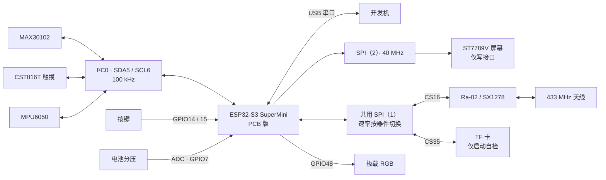

# LifeBeacon 当前版硬件技术手册

适用设备：ESP32-S3 SuperMini + Ra-02 的 PCB 联调版，以及 `Program/prog_test` 独立接线测试版。固件、算法和报文定义见[Beacon端固件技术手册](../README.md)。

## 1. 版本依据与使用原则

接线以当前 `Program/prog_PCB_test/pcb_config.py`、`main.py`、`pcb_runtime.py` 和独立版对应文件为准。`Hardware/LifeBeacon.eprj2` 是电路工程；`Hardware/Export/20261013.04 v1.2/` 保存制造归档。归档中的网络与实物飞线、换件可能不同，装配人员应逐项核对第3、4节的运行接口。

GPIO 表中的编号是主控引脚号，连接器脚序应查模组手册和板上标记。MAX30102 模组输入与裸芯片电源轨须分别核对。PCB DRC、制造文件和电气指标尚无对应复核记录；第10节列出待实板执行的验收项目。

| 项目 | 归档资料或检查对象 | 运行配置或实物报告 | 联调时的处理 |
| --- | --- | --- | --- |
| I²C 上拉 | 网表 R1/R2 型号为 4.7 kΩ | 用户报告实物为 2.2 kΩ，未复测 | 测量实物及并联阻值 |
| TF 片选 | 归档网表 GPIO35 为匿名网络 | GPIO35 | 检查实物是否已连接TF片选 |
| GPIO48 | 板载 RGB | RGB驱动使用 | TF片选另接GPIO35 |
| 射频配置 | Ra-02/SX1278 | 见软件手册第3、9节 | 同步核对接收中心设置 |
| MAX/MPU | 传感器实装状态 | 程序探测器件并启动独立线程 | 器件缺失时记录失败，其他设备继续 |
| 按键 | 归档网表 R9/R11 接地支路 | 固件输入上拉、低有效 | 实测按键极性，见第7节 |

## 2. 系统组成与数据通路

PCB 版的传感器共用 I²C，LoRa 与 TF 共用 SPI，屏幕独占另一条 SPI。MAX 提供心率与血氧的光学输入；MPU 提供运动参考，以及陀螺仪、温度日志。按键和触摸只输出交互日志。设备未接 GPS，报文定位标志固定为0。

独立测试版启用 MAX、触摸探测、LoRa、ADC 和 RGB，屏幕、TF、MPU 与 PCB 按键保持未初始化。切换硬件版本时须更换整套配置和依赖文件，单独替换 `main.py` 会保留错误线序。

## 3. PCB 版完整 GPIO 表

| GPIO | 固件名称 | 网络/连接对象 | 配置与用途 |
| ---: | --- | --- | --- |
| 1 | LORA_DIO1 | Ra-02 DIO1 | 输入，当前主流程未依赖其事件 |
| 2 | LORA_DIO0 | Ra-02 DIO0 | 输入；驱动轮询 IRQ 寄存器确认 RX/TX |
| 3 | LORA_RST | Ra-02 RESET | 启动低脉冲复位 |
| 4 | HR_INT | MAX30102 INT | 输入上拉，日志显示；FIFO由线程轮询 |
| 5 | I2C_SDA | MAX、触摸、MPU SDA | I²C0，100 kHz |
| 6 | I2C_SCL | MAX、触摸、MPU SCL | I²C0，100 kHz |
| 7 | BAT_TEST | 电池分压节点 | ADC输入，ATTN_11DB |
| 8 | SCREEN_BL | 背光控制 | 高电平开，实际驱动路径需核实 |
| 9 | SCREEN_DC | ST7789V DC | 命令/数据选择 |
| 10 | SCREEN_CS | ST7789V CS | 低有效 |
| 11 | SCREEN_SCK | ST7789V SCK | SPI(2)，40 MHz |
| 12 | SCREEN_MOSI | ST7789V MOSI | 屏幕仅写，不读回 |
| 13 | SCREEN_RST | ST7789V RESET | 屏幕复位 |
| 14 | BTN2 | SW2 | 输入上拉，固件按下=0 |
| 15 | BTN1 | SW1 | 输入上拉，固件按下=0 |
| 16 | LORA_CS | Ra-02 NSS | SPI(1)，低有效 |
| 17 | LORA_MOSI | Ra-02/TF MOSI | SPI(1)，LoRa阶段10 MHz |
| 18 | LORA_MISO | Ra-02/TF MISO | 共用返回线，未选器件必须释放 |
| 21 | LORA_SCK | Ra-02/TF SCK | 共用时钟 |
| 33 | TOUCH_RST | CST816T RESET | 低10 ms，高100 ms后访问 |
| 34 | TP_INT | CST816T INT | 输入上拉，下降沿置位事件 |
| 35 | TF_CS | TF卡CS | 独立片选，空闲为高 |
| 38 | MPU_INT | MPU6050 INT | 输入上拉，日志显示 |
| 48 | RGB_PIN | 板载NeoPixel | 单灯，软件亮度16/255 |

MicroPython 的 `SPI(1)`、`SPI(2)` 对应本配置使用的 ESP32-S3 SPI2、SPI3 控制器。GPIO33-38 的可用性取决于实际模组的 Flash/PSRAM 接法与引出方式；装配前应确认 GPIO35 未被内部存储器占用。

配置来源：[PCB 引脚定义](../pcb_config.py)，驱动入口为 `make_radio()`。

## 4. 独立测试版接线表

| 功能 | GPIO / 配置 |
| --- | --- |
| I²C SDA / SCL | 5 / 4，100 kHz |
| MAX INT / 触摸 INT | 7 / 6 |
| 电池ADC | 1 |
| LoRa DIO0 / DIO1 / RESET | 8 / 9 / 14 |
| LoRa CS / MOSI / MISO / SCK | 10 / 11 / 13 / 12 |
| LoRa SPI | SPI(2)，5 MHz |
| RGB | GPIO48 |
| 屏幕、TF、MPU、PCB按键 | 不初始化 |

独立版通过 `0x15` 探测触摸芯片，不驱动 GPIO33 进行硬复位。接线时应按本表核对 LoRa 网络，避免沿用屏幕预留线序。

配置来源：独立版引脚定义（工作区文件：`Program/prog_test/pcb_config.py`）。

## 5. 电源、地与电池测量

数字总线使用3.3 V逻辑，模块和分析仪须共地。Ra-02 的3.3 V输入应接稳压电源。MAX 模组的 VIN/电压选择脚按具体模组规格连接，裸芯片各电源轨须单独核对。TF卡使用3.3 V SPI；带5 V转换电路的模块还应检查转换延迟和MISO释放能力。

电池充电电流、保护参数和USB/电池切换规格尚未核实。接入外部供电前，应检查 SuperMini 的 BAT+/BAT−、USB和3V3路径，防止反灌。上电后测量静态3V3和LoRa发射时的模块端电压；USB枚举正常仍可能伴随射频供电跌落。

制造归档中，R3连接BAT−与BAT_TEST，R4连接BAT_TEST与BAT+；料号对应20 kΩ和10 kΩ，理想还原倍数约1.5。软件PCB版采用 `1.67-0.1=1.57`，独立版采用1.67。装配人员应测量实装电阻、BAT_TEST电压和电池电压后校准倍数。

ADC算法将原始值线性换算为3300 mV，再乘还原倍数，未补偿ADC非线性。电量换算范围见[软件参数表](../README.md#3-当前参数表)。该百分比是线性估计；调试人员还须确认满电时ADC节点符合引脚电压限制，衰减设置不能代替输入限压。

实现来源：两版 `main.py` 的 `battery_mv()`、`battery_percent()`；分压连接依据为第1节所列归档网表。

## 6. I²C 与传感器模块

| 器件 | 地址 | 自检/配置关键点 |
| --- | --- | --- |
| MAX30102 | 0x57 | PART_ID寄存器0xFF应为0x15；100sps双通道FIFO |
| CST816T兼容触摸 | 0x15 | 读0xA7标识、0x01起6字节事件/坐标 |
| MPU6050 | 0x68或0x69 | WHO_AM_I寄存器0x75；旧PCB AD0接地，通常0x68 |

MAX 的初始化寄存器和FIFO格式由[软件手册第6节](../README.md#6-max30102-驱动与数据有效性)统一定义。佩戴测试应限制漏光和接触滑动，在静止条件下建立基线。验收须观察FIFO数据和有效标志，LED点亮只能确认发光现象。

MPU配置为±2 g、±250 °/s，内部100 Hz。线程约每20 ms读取最新数据，未保存每个内部样本。运动参考使用加速度模长减慢均值，安装松动会影响该参考。MPU缺失时PPG继续运行，软件关闭运动补偿并标记未验证。

I²C空闲时SDA和SCL均应接近3.3 V。联调记录中的上拉为2.2 kΩ，装配人员应测量实物，并计入模组自带上拉的并联影响。电阻测量须在断电后进行。SDA约0.2 V而SCL约3.3 V时，应先隔离SDA支路；移除MPU后恢复可将故障范围缩到MPU及其连接，仍需区分供电、接线和芯片故障。

I²C排查步骤待实板验证。先断电检查短路和方向，再只保留主控与上拉。逐个接入MAX、触摸和MPU，每次测量电源与空闲电平，比较器件端和主控端的SDA/SCL，最后检查起始条件、地址和第9时钟ACK。操作人员应在记录中保留每次接入的结果；异常时断电并恢复到上一组正常连接。`scan=[]`可能由缺电、断线、地址错误或总线占用引起。触摸休眠也可能跳过扫描，PCB程序会在复位后直接读取寄存器。

实现来源：[Runtime.i2c_init、touch_init、mpu_worker](../pcb_runtime.py)；地址与ID条件还见 `main.py` 的 `init_max30102()`。

## 7. 屏幕、触摸与按键

ST7789V使用240×280窗口和RGB565，Y偏移20、MADCTL=0x00、反色启用，GPIO8高电平打开背光。屏幕SPI与LoRa/TF分离。初始化后程序发送色条并显示白底彩色日志；ASCII过滤会将中文等字符替换为`?`。显示接口无MISO读回，`init sent`后仍需目视检查方向、偏移和颜色。

显示控制器走SPI，触摸控制器走I²C，二者须分别验收。触摸复位脚33和INT脚34应各自连通。程序输出控制器坐标，尚未按面板旋转方向标定。

PCB按键使用内部上拉、低有效和35 ms去抖，按下与释放只产生日志，未实现SOS或长按动作。归档网表的按键支路包含10 kΩ下拉，与软件极性假设存在疑点。装配人员应记录SW1/SW2松开和按下时的电压；若松开低、按下高，应调整电路或软件极性。

实现来源：[屏幕驱动](../pcb_screen.py)、[运行配置](../pcb_config.py)及 `pcb_runtime.py` 的 `inputs()`。

## 8. TF 与共用 SPI

程序启动时将LoRa_CS和TF_CS拉高，SD驱动以100 kHz进入SPI模式。驱动识别SD v1/v2和SDHC，按512字节块读写。自检挂载已有FAT文件系统，写入并读回 `/sd/Hello.txt`，同步卸载后恢复LoRa的SPI速率。该操作会覆盖同名Hello.txt，不格式化卡。

TF仅用于启动自检，未连续记录PPG或报文。卡初始化位于LoRa之前，失败或超时会延迟开始监听；异常记录后程序继续。若增加运行期写卡，维护人员须同时管理片选、SPI速率和事务互斥，避免两个器件争用总线。

实现来源：[SDCard](../pcb_sdcard.py)与 `pcb_runtime.py` 的 `tf_test()`。

## 9. 射频与接收中心配合

Ra-02/SX1278的频点、功率和PHY参数见[软件参数表](../README.md#3-当前参数表)，CQ切频流程见[软件手册第9节](../README.md#9-cq应答状态机与led)。收发共用一颗半双工芯片，发射期间无法监听CQ。

射频连接应使用匹配433 MHz频段的天线和模块接口。发射前接好天线，并检查周围金属、电池、排线和外壳对匹配的影响。天线驻波、实际功率、杂散和通信距离尚无对应实测记录。驱动的功率钳位范围为2-17 dBm；20 dBm所需的高功率配置未实现。

接收中心须使用相同的BW、SF、头模式、同步字和CRC规则发送CQ，再及时切到返回频点接收。回包延时受软件调度影响，主控也未实现频率扫描或IQ记录。

实现来源：[SX1278驱动](../sx1278.py)。

## 10. 指示灯与联调验收

| 状态 | RGB48行为 |
| --- | --- |
| 普通信标发射 | 黄色；成功绿约150 ms；失败红约600 ms |
| 合法CQ已接收 | 红灯每250 ms切换亮灭，完整周期约500 ms |
| 等待/发送类型2应答 | 持续红色闪烁，由主循环服务 |
| 类型2发送完成/失败 | 成功绿约150 ms；失败红约600 ms，恢复监听 |

实板验收清单（草稿）：下列步骤待实板验证。接线、换卡和供电操作由联调人员负责；测电阻前断电，恢复接线后再上电。TF自检会覆盖Hello.txt，测试前应另行备份同名文件。验收记录须包含照片、串口日志和分析仪记录；发现供电或接线异常时，断电并恢复到最近一组正常连接。

1. 无外设：确认主控型号、存储器引脚占用、USB串口、3V3和公共地。
2. I²C单器件：分别记录地址、ID、空闲电平和ACK，确认加入其他器件后仍正常。
3. PPG静止：确认FIFO持续读取，完成预热后观察HR、SpO2、SQI；移开手指应撤销有效标志。
4. MPU运动：检查静止模长约1 g，晃动时motion变化；缺失时日志标记运动未验证。
5. 屏幕/交互：背光、色条、白底日志、按键和触摸日志逐项确认。
6. TF：确认Hello.txt内容、读回通过和卸载后的LoRa可用性。
7. 射频：确认周期类型1；发送正确CQ后观察红闪、约2.5秒后的类型2及实际频点；坏CRC不应触发。
8. 长时运行：记录掉包、FIFO溢出、复位、供电波动和温升；软件自检不能替代此项。

## 11. 资料位置与维护

- 当前硬件工程：`Hardware/LifeBeacon.eprj2`。
- v1.2制造归档：`Hardware/Export/20261013.04 v1.2/`，含原理图、PCB PDF、网表和Gerber。
- 模组手册：`Hardware/References/`；参考清单为其中的 `README_技术手册清单.md`。
- PCB运行配置：[pcb_config.py](../pcb_config.py)。
- 独立版运行配置：pcb_config.py（工作区文件：`Program/prog_test/pcb_config.py`）。

维护人员变更器件、飞线、上拉、供电或GPIO后，应同步更新电路工程、运行配置和本文。制造归档保留原文件，作为对应生产批次的依据。
